# NovelForge

[](https://github.com/YangLiu68/NovelForge/actions/workflows/ci.yml)

**An evidence-grounded workspace for long fiction.** NovelForge reads a manuscript, extracts
the facts it states (who has which eye colour, who is where on which day, who has died, who can
swim, what the rules of the world are), and finds the places where the story contradicts
itself. It also checks story logic: whether each character's key actions have a reason in the
text that fits their background, personality and situation, whether villains have motives,
whether the plot holds (knowledge leaks, rescues from nowhere, setups never paid off) and where
the pacing sags, with revisions to fix it. Every fact and every finding points at the exact words
it came from, and nothing becomes canon until the author says so. English and Chinese novels.

It is not a chatbot wrapper. The core is a reproducible consistency benchmark: a seeded novel
generator with planted contradictions and look-alike negatives, used to measure retrieval,
extraction and contradiction detection, including how much each kind of memory helps.

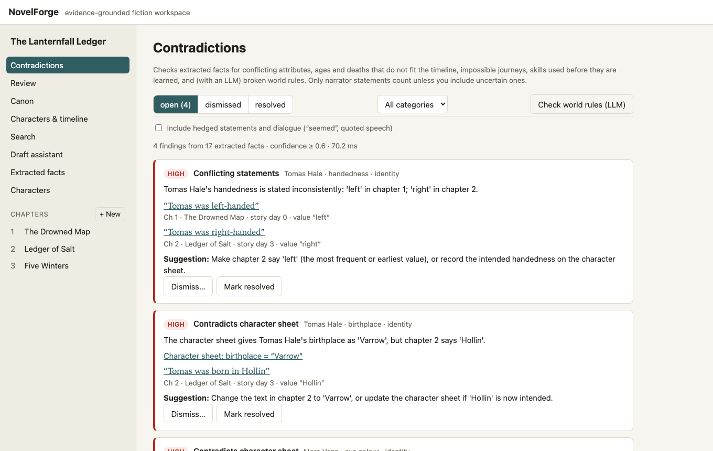

## What it does

- **Write**: markdown chapters with preview, revision history and optimistic locking (a save
  based on a stale version is refused, never silently merged).
- **Extract**: a deterministic rule extractor runs on every save (a 186,000-word novel in about
  2 s). It follows "her grey eyes" back to a name only when exactly one character fits, and
  abstains otherwise. An LLM extractor (Claude through the Anthropic SDK or OpenRouter, a local Ollama model, or an
  offline mock) runs
  as an idempotent background job with a strict JSON schema. Every quote is verified against
  the text, and every literal value against its quote; facts that fail are rejected with a
  reason.
- **Review**: extracted facts are proposals. Accepting one updates canon (character sheets,
  locations, world rules, timeline, plot threads, relationships) with an audit log; accepting a
  fact that contradicts canon requires explicit confirmation. Decisions survive later edits.
- **Check**: contradictions in identity (attributes, character sheet), timeline (ages, the dead
  reappearing), location (journeys faster than the travel time), abilities (skills used before
  they are learned) and world rules (LLM judge over retrieved passages). Each finding has an
  explanation, evidence, severity and a suggested fix, and can be dismissed (with a reason) or
  resolved; fixed text resolves it automatically.
- **Search**: hybrid retrieval, PostgreSQL full-text plus pgvector embeddings fused with
  reciprocal rank fusion, optional cross-encoder reranking, and per-result "why this ranked".
- **Story logic** (人物与故事线): for every key action, the model answers grounded questions (is
  this a choice that needs a reason? which earlier passage gives it? what does it go against?)
  and the verdict is computed by rule: consistent, against the character, villainy without cause
  ("she just could not stand her" is not a motive), unmotivated, or explained later by a planted
  reveal. Plus knowledge leaks (a secret used without a source), rescues by someone never seen
  before, setups whose key word never comes back, a tension curve with flat stretches and missing
  hooks, and a revision plan (plant a setup, a setback that opens an opportunity, a reversal,
  past-life memory, a cliffhanger) whose items open the draft assistant.
- **Chinese**: sentence and dialogue handling (“”「」), 第X章 headings, character counts, bigram
  search that works under any database locale, a Chinese rule extractor (琥珀色的眼睛, 今年五十三了,
  不会水, 她 resolved only when unambiguous) and a Chinese prompt for the LLM extractor, feeding the
  same contradiction checks with findings explained in Chinese, and Chinese prompts and UI for
  the story-logic page.
- **Draft**: a bounded plan → draft → check → revise workflow with human approval at each
  checkpoint, streamed over SSE with cancel and retry. The checker runs the contradiction
  detectors on the draft against the rest of the book and cites both sides.
- **See**: an interactive character co-occurrence graph and a per-character timeline with
  contradictions drawn between the facts that clash.

## Screens

| | |
|---|---|
| 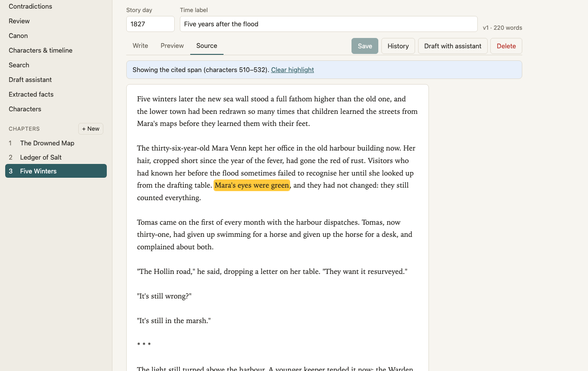 | 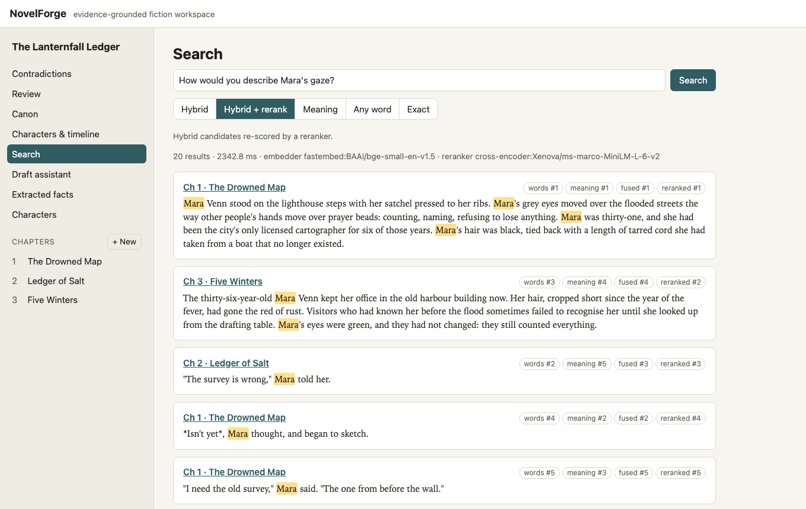 |
| Every citation opens the chapter at the exact quoted span. | Hybrid search shows each hit's rank by words, meaning, fusion and reranking. |
| 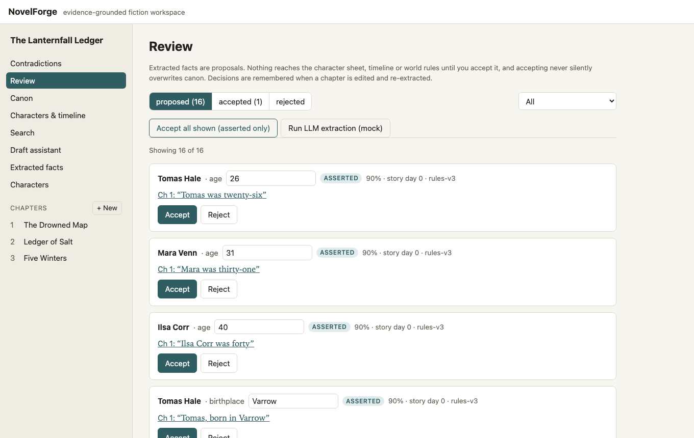 | 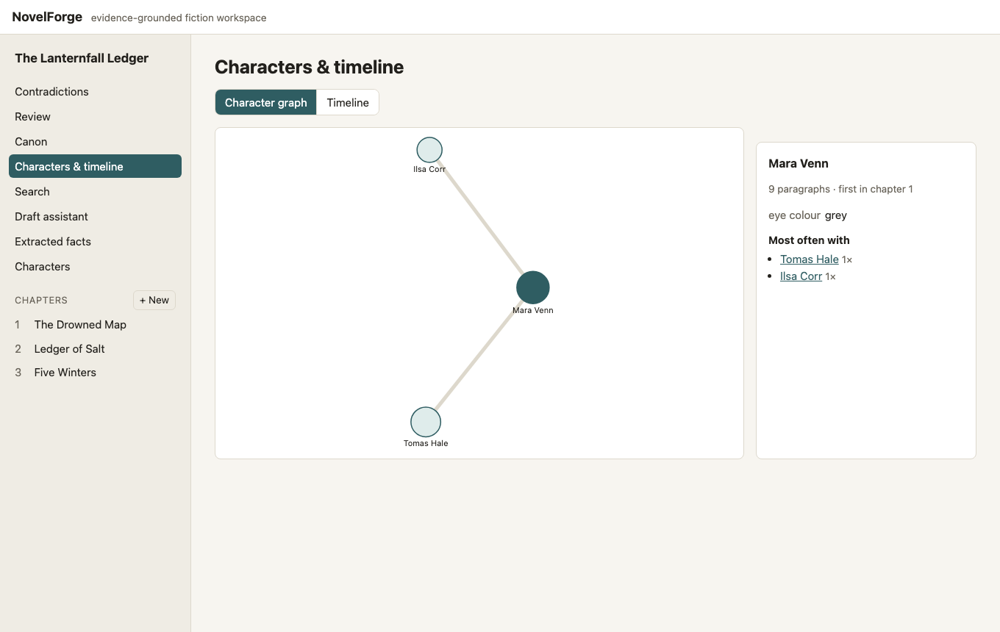 |
| Extracted facts wait for review before they become canon. | Who appears with whom, with the paragraphs behind each link. |
| 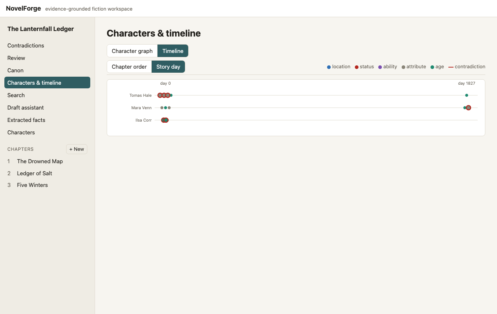 | 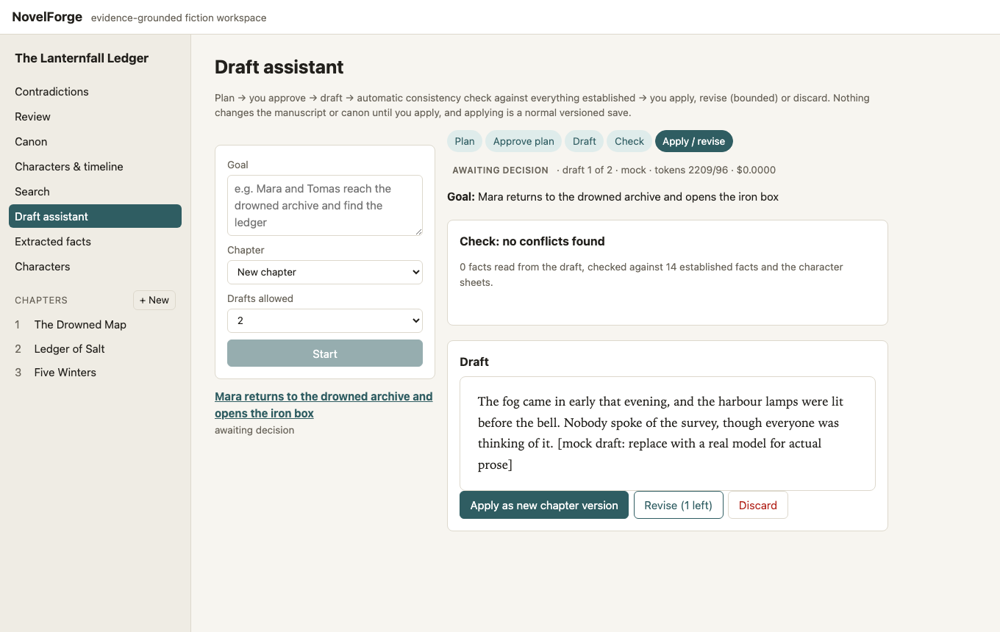 |
| Facts by story day; red rings are facts in an open contradiction. | Plan, draft, check, then apply, revise or discard (mock model shown). |
| 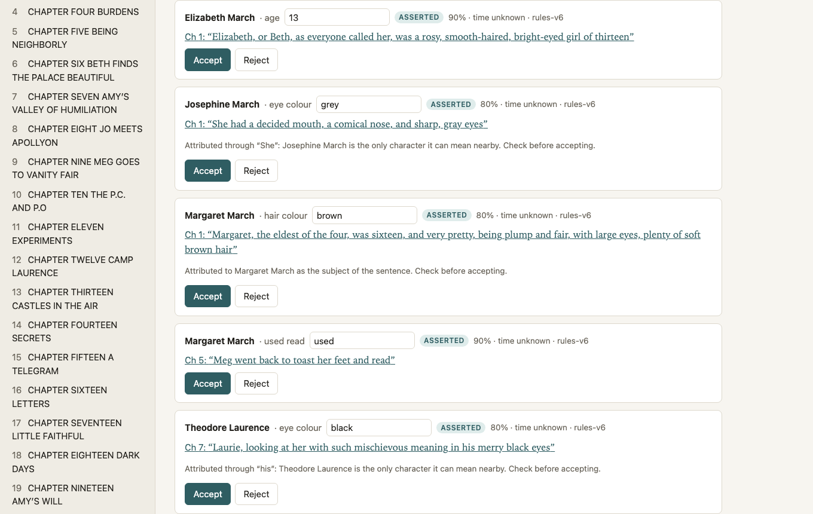 | 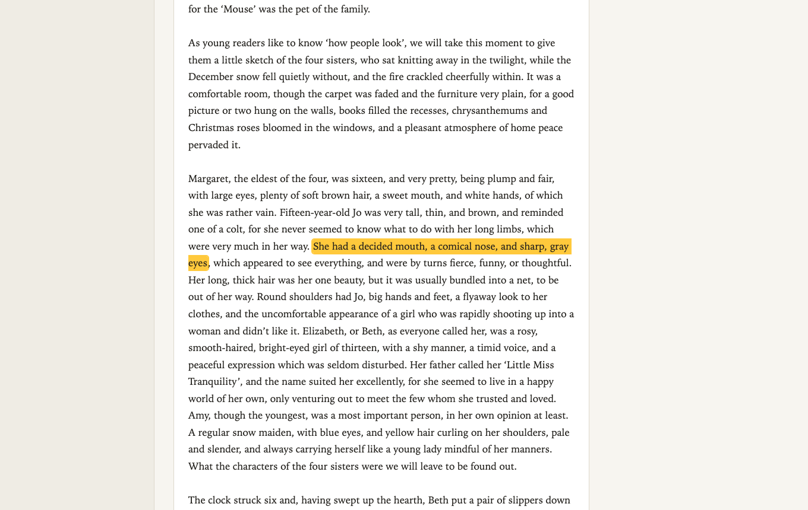 |
| *Little Women* imported with `import-text --book little-women`: facts reached through "She" or a sentence's subject say why. | "She had … sharp, gray eyes" is Jo's. Later in the paragraph, "A regular snow maiden, with blue eyes" (Amy) is a miss: the sentence has no subject to attach it to. |
| 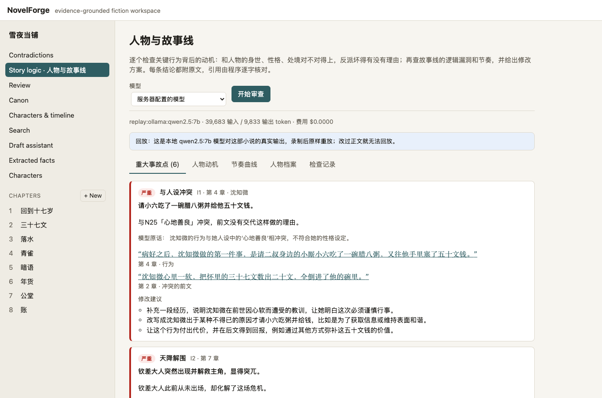 | 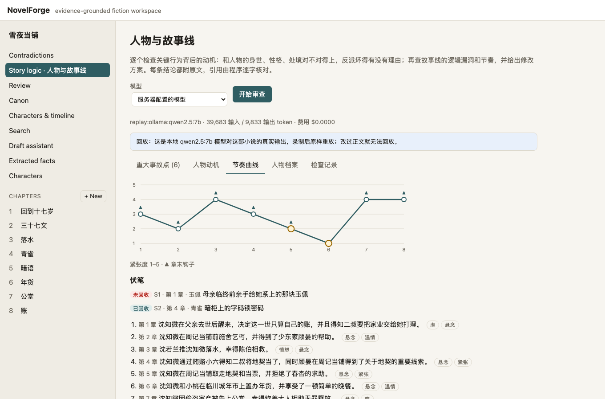 |
| Story logic on 雪夜当铺, replaying the recorded qwen2.5:7b run: each problem states how the verdict was reached and quotes the text. | The tension curve (flat chapters ringed), ending hooks, and whether each setup's key word comes back. |
| 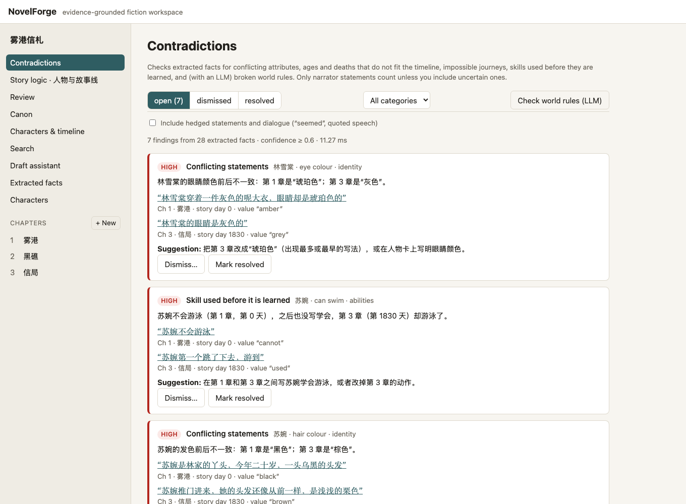 | |
| A Chinese novel: the same checks, explained in Chinese, each quote linked to its sentence. | |

## Quick start (no Docker needed)

Requirements: Python 3.12 with [uv](https://docs.astral.sh/uv/), Node 22.

```bash
# Backend (an embedded PostgreSQL 16 + pgvector is installed as a Python package)
cd backend
uv sync --extra localdb
uv run novelforge migrate
uv run novelforge import-sample          # optional: the three-chapter sample
uv run novelforge serve                  # http://127.0.0.1:8000

# Frontend (second terminal)
cd frontend
npm ci
npm run dev                              # http://localhost:5173
```

### Optional: real models

```bash
uv sync --extra localdb --extra embeddings --extra anthropic
EMBEDDER=fastembed RERANKER=cross-encoder uv run novelforge serve   # local CPU models (~150 MB)
LLM=anthropic LLM_EXTRACTION=true uv run novelforge serve           # Claude (claude-opus-5-5)
LLM=openrouter:anthropic/claude-opus-5.5 LLM_EXTRACTION=true uv run novelforge serve  # via OpenRouter
LLM=ollama:qwen2.5:7b LLM_EXTRACTION=true uv run novelforge serve   # a local Ollama model
```

Claude uses the Anthropic SDK's usual credentials (`ANTHROPIC_API_KEY` or `ant auth login`), or
any Anthropic-compatible endpoint through `ANTHROPIC_BASE_URL` and `ANTHROPIC_AUTH_TOKEN`;
OpenRouter reads `OPENROUTER_API_KEY` (put it in `.env`, which git ignores). With a hosted model,
manuscript text is sent to that service; the default (`mock`) sends nothing anywhere. For
Chinese novels with Claude, `REPORT_PREFER_LLM=true` reports the model's facts in chapters it has
read instead of adding the rules' (fewer false findings, section 9 of BENCHMARK.md). All settings
are in [.env.example](.env.example).

### Docker Compose

```bash
docker compose up --build               # UI http://localhost:8080, API http://localhost:8000
```

CI builds the images, starts the stack and uses it ([scripts/compose-smoke.sh](scripts/compose-smoke.sh):
health, migrations, an English and a Chinese sample imported with their planted findings, the
frontend and its `/api` proxy); the same script runs locally.

## Benchmarks

Everything is reproducible from seeds: `bench/run_all.sh` regenerates the corpora and every
number. Details, failure cases and caveats are in [BENCHMARK.md](BENCHMARK.md). Headline results
on a generated 1,000-chapter novel (125 planted contradictions, 148 look-alike negatives), all
local on an M4 laptop:

| What | Result |
|---|---|
| Retrieval, 800 questions (half paraphrased) | hybrid + cross-encoder R@1 **0.909**, R@10 0.999; full-text alone 0.584, vectors alone 0.614 |
| Contradiction recall by memory type (same claims, same detectors) | chapter alone 0.280 · vector memory 0.584 · hybrid memory 0.512 · **structured claim store 0.664** |
| Contradictions with an LLM (100 chapters, 12 planted) | rules 9/12 · Claude Haiku 5.5 10/12 · **Haiku plus rules 12/12, 0 false findings**, including the world-rule violation only the LLM judge can see |
| False alarms (structured) | **0** findings wrong, 0 of 148 negatives flagged; whole-novel check in 0.5 s |
| Rule extractor (synthetic) | precision 1.0, recall 0.903 (rules-v6; v3 was 0.812); similes and implications are left to the LLM |
| **Real prose**: 4 public-domain novels, 490,000 words, every claim hand-judged | on books held out from rule development: strict precision 0.78, recall of explicit identity facts 0.20 to 0.34 (v3: 0.04 to 0.09); **0 contradiction findings, so 0 false alarms** |
| Real prose with an LLM (2 of the books, Claude Haiku 5.5, every claim hand-judged) | recall **0.32 and 0.43** against the rules' 0.18 and 0.21; identity claims 49 of 51 right; still 0 false alarms; $0.05 to $0.08 a book |
| **Chinese continuity checks** (held-out novels written by separate agent sessions, each scored once with the version frozen before it) | rules: v1 **3 / 9**, v2 **5 / 9**, v3 **5 / 9** and **7 / 9** planted contradictions found, 1 to 3 false findings per novel. **Claude Opus 5.5** (Chinese prompt, via OpenRouter) on the newest novel: **9 / 9**, 1 false finding; facts 98% correct, 86% found (rules 64%); $0.25 |
| **Story logic** (Chinese samples; two held-out novels, the second written by a separate agent and scored once) | newest held-out: **Claude Opus 5.5 4 of 6** planted problems, 0 of 6 traps by hand, $1.49; **Claude Haiku 5.5 3 of 6**, 0 of 6, **$0.05**. First held-out: Opus 3 of 6, 0 of 4 traps (qwen2.5:7b 2 of 6, 1 of 4). Code-side merging cut Claude's unlabelled issues from 11 to 3 there without losing a find |
| LLM extractor on the synthetic novel (100 chapters) | **Claude Haiku 5.5: precision 0.982, recall 0.961** (rules 1.0 / 0.884), and every planted world rule, setup and causal link, for **$0.08**; qwen2.5:3b local: 0.667 / 0.036, too weak to help |
| Model size (Chinese held-out, same frozen prompt) | Haiku 5.5 9/9 contradictions for $0.011, Sonnet 5.5 7/9 for $0.084, Opus 5.5 9/9 for $0.255: the cheapest model is not the weak link |
| Scale, 1.25 M words / 33,277 paragraphs | import 44 s, chapter save p50 247 ms, hybrid search p50 173 ms, report refresh 774 ms, 258 MB database (on a saturated shared machine) |

The synthetic corpus is templated, so its numbers measure the pipeline against known answers,
not literary understanding; the real-prose rows show how far they fall on prose nobody wrote
for the benchmark ([bench/real/](bench/real/README.md)). The contradiction recall figures use
the rule extractor only, so they count all 28 world-rule violations (which need the LLM judge)
as misses.

## Commands

`make help` lists the common tasks (`make setup`, `make api`, `make web`, `make check`,
`make bench`). The API's OpenAPI docs are at http://127.0.0.1:8000/docs.

| Command (from `backend/`) | What it does |
|---|---|
| `uv run novelforge migrate [head\|base]` | Apply or roll back migrations |
| `uv run novelforge serve [--reload]` | Run the API (with an in-process job worker) |
| `uv run novelforge worker [--once]` | Run background jobs in a separate process |
| `uv run novelforge import-sample [NAME]` / `import-corpus DIR` | Import a sample (`lanternfall`; Chinese: `wugang-xinzha`, `linjiang-biaoqi`, `wuling-chashi`, `taiye-qiushen`, `tuoling-guoqi`, `xueye-dangpu`, `qingshi-du`, `xueye-dangpu-revised`) or a generated corpus |
| `uv run novelforge import-text FILE --title T` / `--book little-women` | Import a plain-text novel (CHAPTER or 第X章 headings) or a public-domain test book |
| `uv run novelforge gen-corpus --chapters N --seed S [--filler F] --out DIR` | Generate a benchmark novel |
| `uv run novelforge eval-sample [NAME] [--llm SPEC [--with-rules] [--replay]]` | Score a sample's contradiction report (rules, an LLM, or both; `--replay` answers from the recording) |
| `uv run novelforge eval-facts NAME [--llm SPEC ...] [--out DIR]` | Claim precision and recall on a sample's labelled facts |
| `uv run novelforge bench-retrieval DIR` | Retrieval: recall@k, MRR, nDCG, latency, tokens |
| `uv run novelforge bench-extraction DIR --extractor rules\|mock\|ollama:M\|anthropic` | Extraction precision/recall per fact type |
| `uv run novelforge bench-consistency DIR` | Contradiction detection with a memory ablation |
| `uv run novelforge bench-load DIR` | Throughput, latency, memory, storage |
| `uv run novelforge bench-real BOOK` | Precision and estimated recall on a public-domain novel (hand labels) |
| `uv run novelforge audit-story SAMPLE --llm ollama:M\|anthropic\|openrouter:M [--replay]` | Story-logic audit of a sample, scored against its labels; `--replay` re-scores a recorded run without the model |
| `uv run pytest` | Backend tests |

From `frontend/`: `npm run dev`, `npm run typecheck`, `npm test`, `npm run build`, `npm run e2e`.

## Documentation

- [ARCHITECTURE.md](ARCHITECTURE.md): components, data model, pipelines, design decisions
- [BENCHMARK.md](BENCHMARK.md): evaluation design, results, ablations, failure cases
- [TESTING.md](TESTING.md): test suites and the latest real results
- [PLAN.md](PLAN.md) and [PROGRESS.md](PROGRESS.md): milestones, acceptance criteria, log
- [LICENSE_NOTES.md](LICENSE_NOTES.md): dependency and model licenses
- [CONTRIBUTING.md](CONTRIBUTING.md): setup, checks, and rules for changes that move numbers
- [docs/demo-walkthrough.md](docs/demo-walkthrough.md) and
  [docs/demo-video-script.md](docs/demo-video-script.md)

MIT licensed ([LICENSE](LICENSE)).
